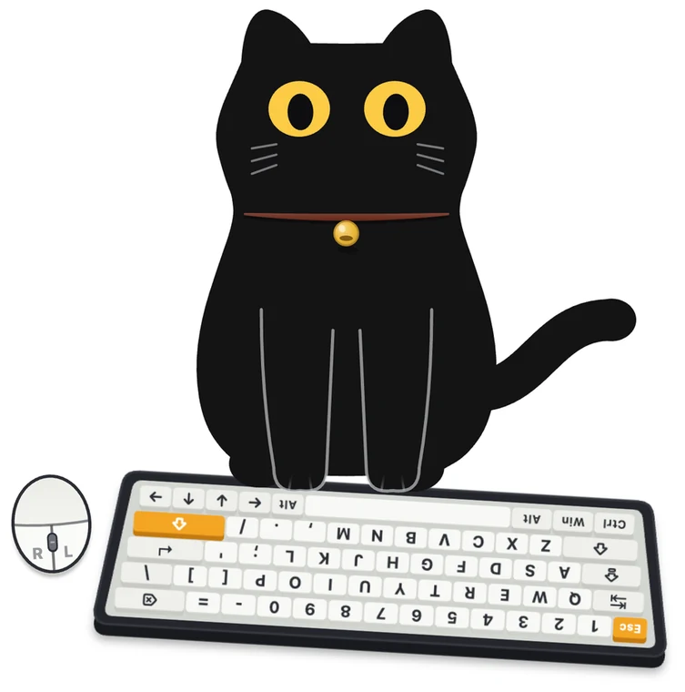
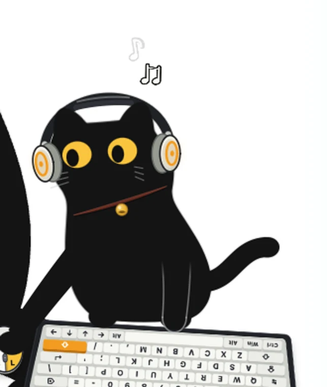
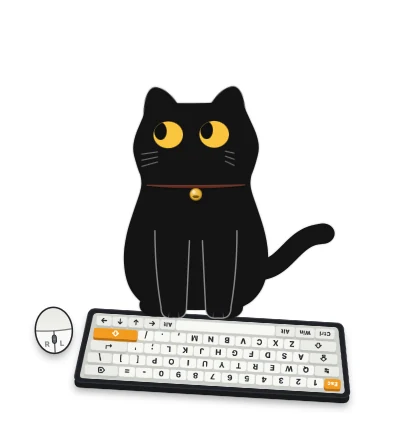
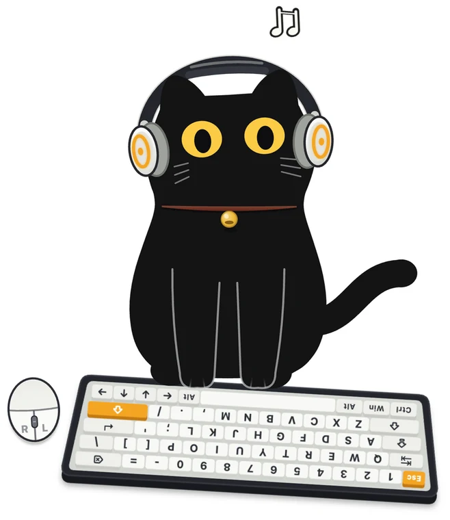
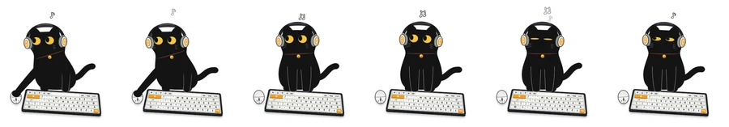
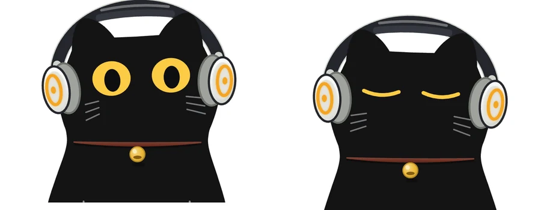
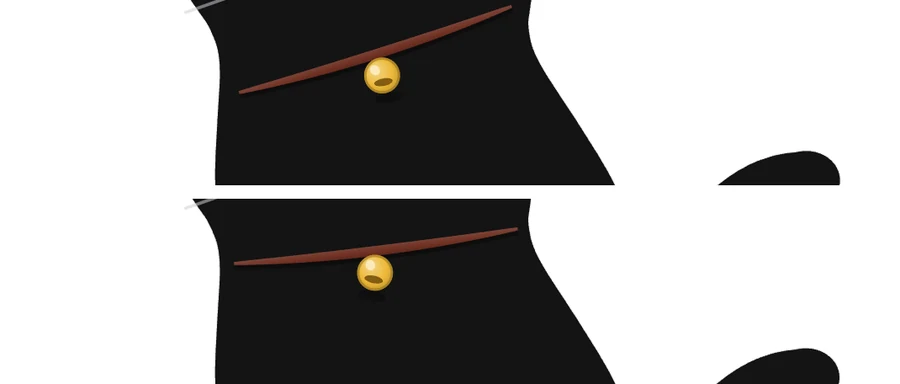
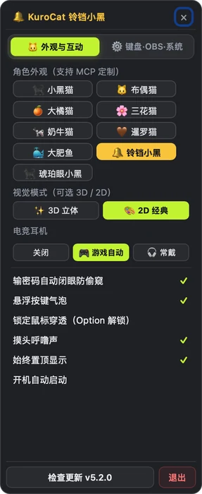

# 🐈‍⬛ KuroCat · 2D Custom Branch (`feat/bellblack-2d`)

<p align="center">
  <a href="./README.md">🇨🇳 简体中文</a> &nbsp;|&nbsp;
  <strong>🇺🇸 English</strong> &nbsp;|&nbsp;
  <a href="./README.ja.md">🇯🇵 日本語</a>
</p>

This is a personal custom branch of [qianyiai/kurocat](https://github.com/qianyiai/kurocat), forked from upstream **5.1.0** (version bumped to **5.2.0** here). Everything upstream ships — keyboard/mouse following, transparent always-on-top window, tray, password privacy guard, MCP, the 3D engine — is kept as-is. This document only records **what this branch adds and changes**.

All changes live in the **2D engine** (`src/catEngine.ts` / `src/catSkins.ts` / `src/main.ts`, plus the tray menu and music detection in `src-tauri`). The 3D engine is untouched.

<p align="center">
  
</p>

## 1. New character: "Bellblack" (`bellblack`)

- **Round-cheek silhouette**: a new `BODY_SLICES_ROUND` outline (widest slice 63.5), rounder and softer than the stock black cat
- **Thin leather cord + gold ball bell**: brick-red cord `#6e2f21` (`COLLAR_2D_STRAP_THICK 3.4`, tapering to fine points at both ends) with a radial-gradient gold bell (radius 6.2, flat oval sound hole), replacing the old wide ribbon + dome bell
- **Single-stroke solid paws**: both front legs are now one continuous `drawSeatedLegPath()`, so no more "two floating lines" on dark fur
- **Keycap-coloured headphones**: earcups recoloured like white keycaps, boom mic removed; only one note floats while playing, drawn on two alternating lanes with a crowding guard so notes never stack
- **Its own menu entry**: tray menu gets a `breed_bellblack` item ("铃铛小黑（圆脸·皮绳铃）"), and the in-app "cat appearance" menu lists the same entry; selecting it shows `KuroCat 铃铛小黑` in the menu header and persists as `catBreed = bellblack` in `settings.json`, surviving restarts

<table>
  <tr>
    <td align="center" width="50%"><br/><sub>Mouse held: the support paw gets a full solid outline instead of two floating lines</sub></td>
    <td align="center" width="50%"><br/><sub>On the real desktop: round cheeks, cord + gold bell, single-stroke paw, 2D keyboard</sub></td>
  </tr>
</table>

## 2. Music groove

When the system is playing music (`src-tauri/src/music_detect.rs`, confirmed by consecutive samples) the cat enters a groove state machine:

- **Base groove**: head nod `beatSin*0.078 + beatHalf*0.026`, face sway `musicNodGain*beatHalf*3.6`, weight shift `+ musicGroove*sin(phase*0.5)*0.055`, tail swinging at half frequency (amplitude 6.4)
- **Random one-shot gestures**: picked from the `enjoy / enjoy / ear / slowBlink / look / tail / tilt` pool every 2200–5200 ms, BPM randomised between 92 and 126 per session
- **Never fights typing**: nod gain is multiplied by `(1 - min(1, typingHunch)*0.55)`, and ordinary idle fidgets are suppressed while `musicGroove < 0.15`

<table>
  <tr>
    <td align="center" width="56%"><br/><sub>Headphones + a single note, no overlap</sub></td>
    <td align="center" width="44%"><br/><sub>Six frames from the real app: head tilt, weight shifting side to side, tail following</sub></td>
  </tr>
</table>

## 3. Eyes-shut bliss

- New `IdleFidget.kind = 'enjoy'` with fixed-time eyelids: **0.38 s shut, 0.45 s open**, total gesture duration randomised **2400–3300 ms**
- Above 0.55 closure it switches to a "relaxed arc" eye branch, wired into both eye paths (built-in and custom skins via `isBlissClosed()`)
- While closed, the nod is multiplied by another `(1 - enjoyEnv*0.45)`, plus a 0.042 lean and `targetGazeY -= 0.12*actEnv` — the cat visibly melts for a moment

<p align="center">
  <br/>
  <sub>Left: normal open eyes. Right: eyes-shut bliss (arc eyes + slight head lean)</sub>
</p>

## 4. Feel fixes

- **Support paw outline**: `drawCustomPlumpArm` takes a `supportLook` flag; on dark fur it falls back to `legLineColor` and closes the paw-ball arc
- **Headband follow**: `drawHeadphonesBack / drawHeadphonesFront` add `turnShift = faceTurnX*0.125`, so the band and earcups track lateral head turns by the same ratio
- **Collar tilt damped**: `collarAnchor()` now attenuates the spine-axis tilt by lean amount (`leanDamp = 1 - min(1,|spineLean|)*0.66`). In the "touching the mouse" pose the cord angle drops from **-17.5°** to **-6.9°**, while idle stays at 0° and light typing sway is unaffected

<p align="center">
  <br/>
  <sub>Same mouse pose: before the fix (about -17.5°) on top, after (about -6.9°) below</sub>
</p>

## 5. Menu and settings

- `src-tauri/src/tray.rs` gains the `breed_bellblack` item and event handler; `lib.rs` builds the list from `all_cats()`, so the embedded menu (`menuMain.ts`) picks up the "铃铛小黑" entry automatically
- `src-tauri/src/music_detect.rs` adds a `get_music_active` command plus the playback polling loop — a coarse "is music playing" check that never reads track metadata
- Version `5.1.0 → 5.2.0` in three places: `package.json`, `src-tauri/Cargo.toml`, `src-tauri/tauri.conf.json`

<p align="center">
  <br/>
  <sub>A standalone entry under "cat appearance"; selecting it highlights it and switches the menu header to `KuroCat 铃铛小黑`</sub>
</p>

## 6. Build and run

Prerequisites: macOS 11+ / Windows 10+, Node.js 18+, a Rust toolchain.

```bash
git clone https://github.com/coocv/kurocat.git -b feat/bellblack-2d
cd kurocat
npm install
npm run tauri:dev      # local dev
npm run tauri:build    # release build
```

On macOS, keeping the Accessibility / Input Monitoring grants across versions requires signing with one **fixed** self-signed certificate: leave `signingIdentity` out of `tauri.conf.json` and sign after packaging

```bash
codesign --force --deep --sign "your-self-signed-cert" src-tauri/target/release/bundle/macos/KuroCat.app
```

A self-signed certificate cannot replace Apple notarisation, so the first launch still needs approval under Privacy & Security.

## 7. Scope and known limits

- **2D only** — no change to the 3D engine (`catEngine3d.ts`)
- The new character is a built-in breed (`bellblack`), not a `cats.json` custom skin; turning it into a pure custom skin would require parameterising the collar and headphone drawing branches
- If a custom skin in your `cats.json` used spots to fake a collar, those old patches are not removed automatically — delete them by hand
- Build artefacts such as `src-tauri/gen/schemas` are gitignored

## 8. Upstream and licence

Upstream project and docs: [qianyiai/kurocat](https://github.com/qianyiai/kurocat), MIT License (see [LICENSE](LICENSE)). This branch only touches 2D rendering and characters; all upstream attribution and licence notices are retained.
