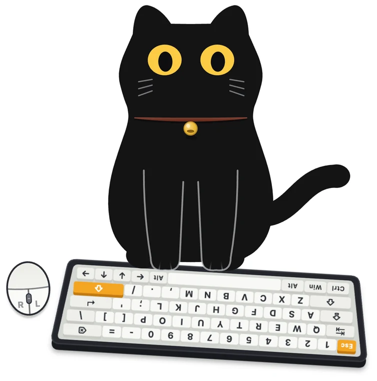
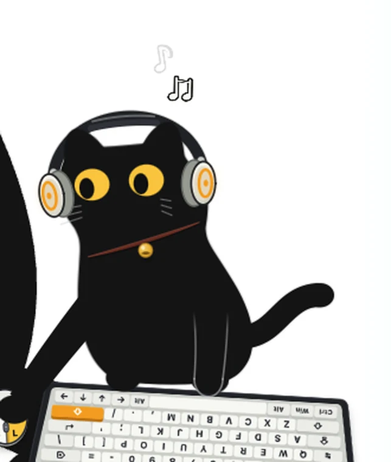
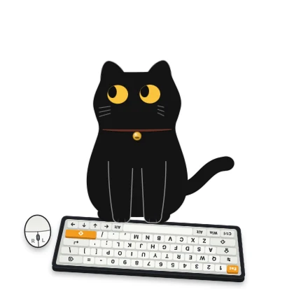
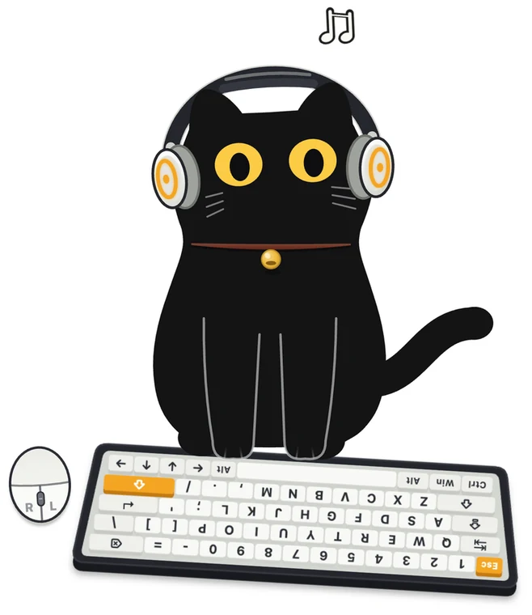
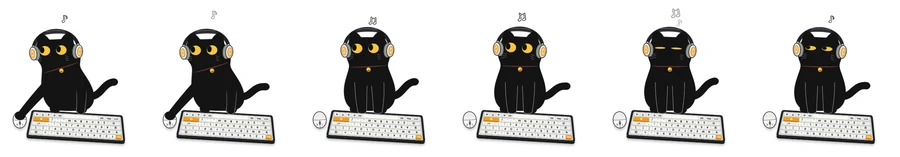
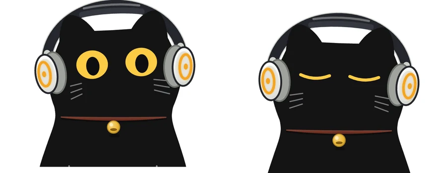
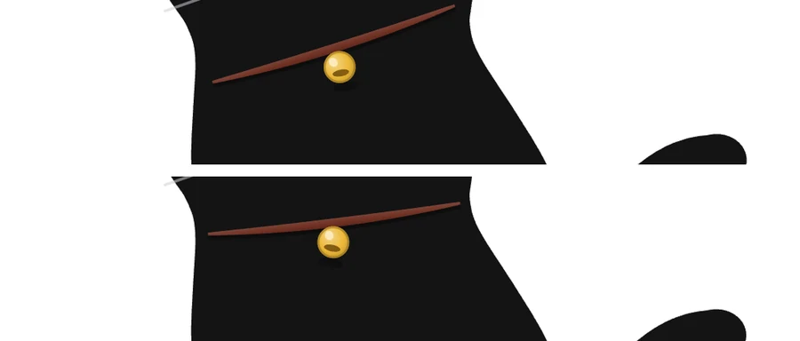
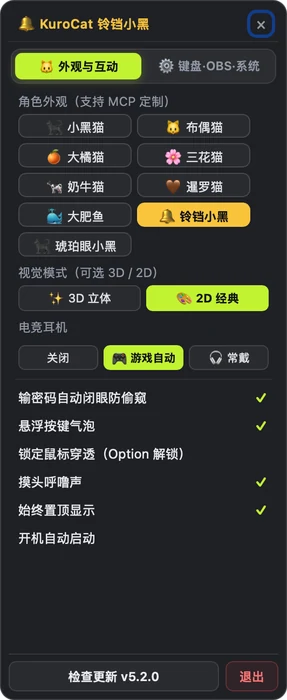

# 🐈‍⬛ KuroCat · 2D カスタムブランチ（`feat/bellblack-2d`）

<p align="center">
  <a href="./README.md">🇨🇳 简体中文</a> &nbsp;|&nbsp;
  <a href="./README.en.md">🇺🇸 English</a> &nbsp;|&nbsp;
  <strong>🇯🇵 日本語</strong>
</p>

[qianyiai/kurocat](https://github.com/qianyiai/kurocat) の個人用カスタムブランチです。上流の **5.1.0** をベースにしています（本ブランチのバージョンは **5.2.0**）。キーボード・マウス追従、透過最前面ウィンドウ、トレイ、パスワード覗き見防止、MCP、3D エンジンなど上流の機能はすべてそのまま残しています。この文書は**本ブランチが追加・変更した内容だけ**をまとめたものです。

変更はすべて **2D エンジン**（`src/catEngine.ts` / `src/catSkins.ts` / `src/main.ts`、および `src-tauri` のメニューと音楽検出）にあり、3D には手を入れていません。

<p align="center">
  
</p>

## 1. 新キャラクター「鈴付き黒猫」（`bellblack`）

- **丸い頬のシルエット**：新しい `BODY_SLICES_ROUND` 輪郭（最大幅 63.5）を追加。標準の黒猫より丸く柔らかい印象
- **細い革紐＋金の鈴**：れんが色の革紐 `#6e2f21`（`COLLAR_2D_STRAP_THICK 3.4`、両端は細く先細り）に、放射状グラデーションの金の鈴（半径 6.2、偏平な楕円の音孔）を合わせ、以前の太いリボン＋ドーム型鈴を置き換え
- **一筆の実体ある前足**：両前脚を連続した `drawSeatedLegPath()` に変更。黒い毛でも「宙に浮いた 2 本の線」にならない
- **キーキャップ配色のヘッドホン**：イヤーカップを白いキーキャップ風に変更し、ブームマイクを削除。再生中は音符が 1 つだけ浮かび、2 本の交互レーンと重なり防止で音符が決して重ならない
- **独立したメニュー項目**：トレイメニューに `breed_bellblack` の項目「铃铛小黑（圆脸·皮绳铃）」を追加、アプリ内の「見た目」メニューにも同名項目が並ぶ。選択するとメニューヘッダーが `KuroCat 铃铛小黑` になり、`settings.json` の `catBreed` に `bellblack` として保存され、再起動後も維持される

<table>
  <tr>
    <td align="center" width="50%"><br/><sub>マウス押下時：支える前足に完全な輪郭が付き、浮いた 2 本の線にならない</sub></td>
    <td align="center" width="50%"><br/><sub>実機：丸い頬＋革紐と金鈴＋一筆の前足＋2D キーボード</sub></td>
  </tr>
</table>

## 2. 音楽に合わせたグルーヴ

システムで音楽が再生されていると（`src-tauri/src/music_detect.rs`、連続サンプリングで判定）、グルーヴ状態に入ります：

- **基本の動き**：うなずき `beatSin*0.078 + beatHalf*0.026`、顔の揺れ `musicNodGain*beatHalf*3.6`、重心移動 `+ musicGroove*sin(phase*0.5)*0.055`、しっぽは半分の周期で振幅 6.4
- **ランダムな単発ジェスチャー**：`enjoy / enjoy / ear / slowBlink / look / tail / tilt` のプールから 2200–5200 ms 間隔で抽選、BPM はセッションごとに 92〜126 でランダム
- **タイピングを邪魔しない**：うなずきゲインに `(1 - min(1, typingHunch)*0.55)` を掛け、`musicGroove < 0.15` のときは通常の idle の小動作を抑制

<table>
  <tr>
    <td align="center" width="56%"><br/><sub>ヘッドホン＋音符 1 つ、重ならない</sub></td>
    <td align="center" width="44%"><br/><sub>実機 6 フレーム：首の傾き、重心の入れ替え、しっぽの追随</sub></td>
  </tr>
</table>

## 3. 目を閉じてうっとり

- `IdleFidget.kind = 'enjoy'` を追加。まぶたは固定タイミングで **0.38 秒閉じ、0.45 秒開く**、ジェスチャー全体の長さは **2400〜3300 ms** でランダム
- 閉じ具合が 0.55 を超えると「リラックスした弧」の目に切り替わる（標準・カスタム両方の目の描画経路に `isBlissClosed()` で組み込み）
- 閉眼中はうなずきにさらに `(1 - enjoyEnv*0.45)` を掛け、0.042 の傾きと `targetGazeY -= 0.12*actEnv` を加えて、一瞬だけ「とろける」

<p align="center">
  <br/>
  <sub>左：通常の開眼。右：目を閉じてうっとり（弧状の目＋わずかな首の傾き）</sub>
</p>

## 4. 手触りの修正

- **支える前足の輪郭**：`drawCustomPlumpArm` に `supportLook` を追加。黒い毛では `legLineColor` にフォールバックし、肉球の弧を閉じる
- **ヘッドバンドの追従**：`drawHeadphonesBack / drawHeadphonesFront` に `turnShift = faceTurnX*0.125` を追加。横を向いたときバンドとイヤーカップが同じ比率で追従
- **首輪の傾きを減衰**：`collarAnchor()` で背骨軸の傾きを傾斜量に応じて減衰（`leanDamp = 1 - min(1,|spineLean|)*0.66`）。「マウスを触る」姿勢で革紐と水平の角度が **-17.5°** から **-6.9°** に、立ち姿は 0° のまま、タイピング時の軽い揺れには影響なし

<p align="center">
  <br/>
  <sub>同じマウス姿勢：上は修正前（約 -17.5°）、下は修正後（約 -6.9°）</sub>
</p>

## 5. メニューと設定

- `src-tauri/src/tray.rs` に `breed_bellblack` の項目とイベントを追加。`lib.rs` のキャラクター一覧は `all_cats()` から生成されるため、アプリ内メニュー（`menuMain.ts`）にも「铃铛小黑」が自動で並ぶ
- `src-tauri/src/music_detect.rs` に `get_music_active` コマンドと再生検出のポーリングを追加。「再生中かどうか」だけを見る粗い判定で、曲情報は読まない
- バージョン `5.1.0 → 5.2.0`：`package.json`、`src-tauri/Cargo.toml`、`src-tauri/tauri.conf.json` の 3 か所

<p align="center">
  <br/>
  <sub>「見た目」に独立項目を追加。選択すると強調表示され、メニューヘッダーが `KuroCat 铃铛小黑` に変わる</sub>
</p>

## 6. ビルドと実行

前提：macOS 11+ / Windows 10+、Node.js 18+、Rust ツールチェーン。

```bash
git clone https://github.com/coocv/kurocat.git -b feat/bellblack-2d
cd kurocat
npm install
npm run tauri:dev      # ローカル開発
npm run tauri:build    # リリースビルド
```

macOS で「アクセシビリティ / 入力監視」の許可をバージョン間で維持するには、**固定の**自己署名証明書で署名します。`tauri.conf.json` に `signingIdentity` を書かず、パッケージ後に手動で署名します

```bash
codesign --force --deep --sign "あなたの自己署名証明書" src-tauri/target/release/bundle/macos/KuroCat.app
```

自己署名証明書は Apple の公証の代わりにはならないため、初回起動時は「プライバシーとセキュリティ」で許可が必要です。

## 7. 範囲と既知の制限

- **2D のみ**。3D エンジン（`catEngine3d.ts`）には一切変更なし
- 新キャラクターは内蔵 breed（`bellblack`）であり、`cats.json` のカスタムスキンではない。純粋なカスタムスキンにするには首輪・ヘッドホン描画の分岐をパラメータ化する必要がある
- `cats.json` の自作スキンで spots を並べて首輪を表現していた場合、その古いパッチは本ブランチでは自動削除されないので手動で消す必要がある
- `src-tauri/gen/schemas` などのビルド生成物はリポジトリに含めず、`.gitignore` に追加済み

## 8. 上流とライセンス

上流プロジェクトとドキュメント：[qianyiai/kurocat](https://github.com/qianyiai/kurocat)、MIT License（[LICENSE](LICENSE) 参照）。本ブランチは 2D 描画とキャラクターのみを変更し、上流のクレジットとライセンス表記はすべて保持しています。
