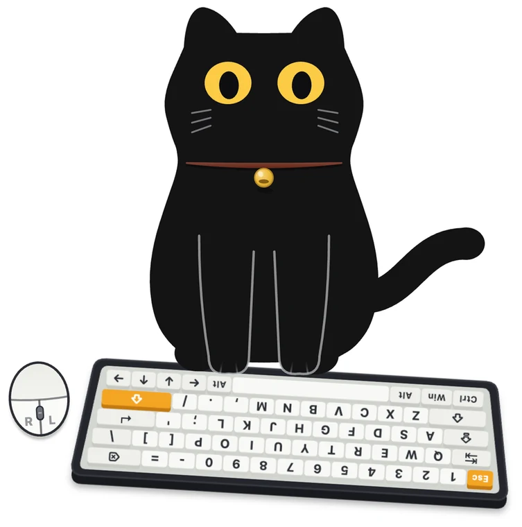
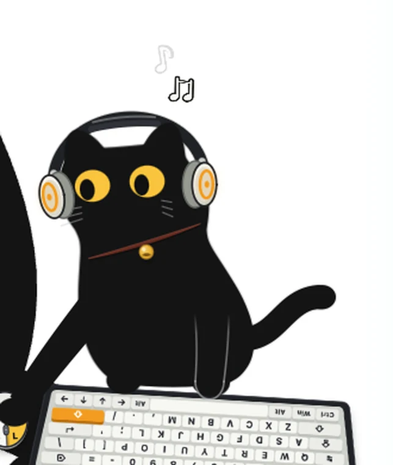
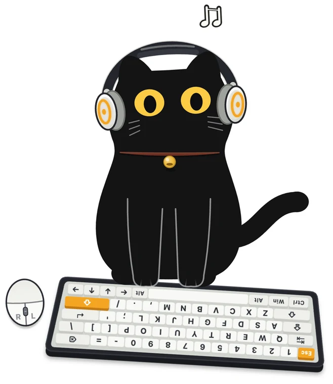
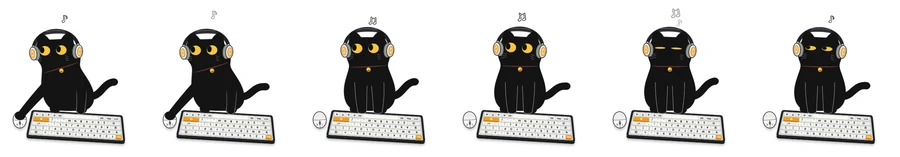
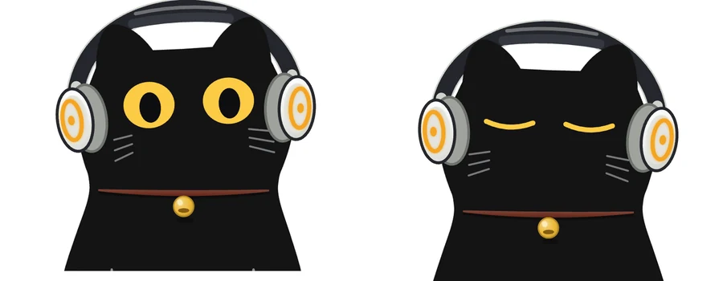

# 🐈‍⬛ KuroCat · 2D 定制分支（`feat/bellblack-2d`）

<p align="center">
  <strong>🇨🇳 简体中文</strong> &nbsp;|&nbsp;
  <a href="./README.en.md">🇺🇸 English</a> &nbsp;|&nbsp;
  <a href="./README.ja.md">🇯🇵 日本語</a>
</p>

[qianyiai/kurocat](https://github.com/qianyiai/kurocat) 的 2D 定制分支，版本 **5.2.0**。上游的键鼠跟随、透明置顶窗口、托盘、密码防偷窥、MCP、3D 引擎照常可用，这一支在 2D 引擎上多养了一只猫。

<p align="center">
  
</p>

> 🔗 **在线预览**：[https://coocv.github.io/kurocat/](https://coocv.github.io/kurocat/?skin=bellblack&collar=none) —— 打开就能摸猫、听歌律动、看闭眼享受；在页面上敲键盘、移动鼠标，猫会同步敲键盘并跟着光标转视线。左上角面板可手动调头部倾斜与扭头。

## 角色：铃铛小黑（`bellblack`）

一只圆脸黑猫，脖子上一条细皮绳挂着小金铃。

- **圆颊剪影**：`BODY_SLICES_ROUND` 轮廓，脸宽而软，腮线饱满
- **细皮绳 + 金球铃**：砖红皮绳 `#6e2f21`，两端收成细尖；金铃为径向渐变球体，侧面扁椭圆出音孔
- **一笔实体爪**：两条前腿一条连续笔画画出，深色毛上同样有完整轮廓与爪球弧
- **键盘配色耳机**：白键帽配色耳罩，无耳麦；听歌时头顶飘一个手绘音符（单音符与双连音两种）
- **独立条目**：托盘菜单与内嵌「角色外观」中都有「铃铛小黑」，选择后写入 `settings.json` 的 `catBreed`，重启保持

<table>
  <tr>
    <td align="center" width="50%"><br/><sub>按住鼠标：一只爪撑地，前脚掌有实体轮廓与爪球弧</sub></td>
    <td align="center" width="50%"><br/><sub>桌面上：圆颊、皮绳金铃、一笔前爪、2D 键盘</sub></td>
  </tr>
</table>

## 听歌律动

系统播放音乐时，整只猫跟着节奏动起来：

- **基础律动**：点头 `beatSin*0.078 + beatHalf*0.026`，面部轻摆 `musicNodGain*beatHalf*3.6`，重心随 `musicGroove*sin(phase*0.5)*0.055` 左右换，尾巴半频摆尾（振幅 6.4）
- **随机动作**：每 2200–5200 ms 从 `enjoy / enjoy / ear / slowBlink / look / tail / tilt` 抽一个，BPM 每轮在 92–126 之间随机
- **打字优先**：点头增益乘 `(1 - min(1, typingHunch)*0.55)`，打字时让位给敲键盘的节奏

<table>
  <tr>
    <td align="center" width="56%"><br/><sub>耳机 + 单音符，两条交替轨道排布</sub></td>
    <td align="center" width="44%"><br/><sub>六帧连拍：头左右倾、重心换边、尾巴跟随</sub></td>
  </tr>
</table>

## 闭眼享受

- `IdleFidget.kind = 'enjoy'`：**0.38 s 合眼、0.45 s 睁眼**，整段 2400–3300 ms
- 闭合度超过 0.55 时眼睛画成放松的弯弧（内置皮肤与自定义皮肤的绘制路径都支持），并伴 0.042 的侧歪、`targetGazeY -= 0.12*actEnv`
- 闭眼期间点头幅度乘 `(1 - enjoyEnv*0.45)`，看起来像瘫在音乐里

<p align="center">
  <br/>
  <sub>左：平常睁眼；右：闭眼享受（弯眼弧 + 头部侧歪）</sub>
</p>

## 动作细节

- **撑爪**：按住鼠标时一只前爪撑地，深色毛下爪球带完整描边
- **头箍跟随**：横向扭头时头箍与耳罩按 `faceTurnX*0.125` 同步转动
- **项圈随姿态**：`collarAnchor()` 用 `leanDamp = 1 - min(1,|spineLean|)*0.66` 让皮绳在强侧身姿态下也接近水平
- **菜单与版本**：`tray.rs` 的 `breed_bellblack`、`music_detect.rs` 的 `get_music_active` 命令与播放轮询；版本号在 `package.json`、`src-tauri/Cargo.toml`、`src-tauri/tauri.conf.json` 三处为 5.2.0

<p align="center">
  <br/>
  <sub>「角色外观」里的独立条目，选中后高亮，菜单头部显示 `KuroCat 铃铛小黑`</sub>
</p>

## 和经典小黑猫的差别

| | 经典小黑猫 | 铃铛小黑 |
|---|---|---|
| 脸型 | 标准剪影 | `faceShape: 'round'`，最宽 63.5 的圆颊 |
| 颈部 | 无饰品 / 自定义 spots | 引擎绘制的细皮绳 + 金球铃 |
| 前腿 | 分段线条 | 一条连续笔画，带实体爪球弧 |
| 耳机 | 深色耳罩 + 发光环 | 白键帽耳罩 + 琥珀环，去掉耳麦 |
| 音符 | — | 手绘音符（单音符、连桁双音符），双轨排布 |
| 听歌 | 只戴耳机 | 点头、面部轻摆、重心换边、尾巴半频 + 随机动作 |
| 闭眼 | 普通眨眼 | `enjoy` 闭眼享受，弯眼弧 + 侧歪 |

## 实现方式

全部是 Canvas 2D 即时绘制，没有贴图资源。

- **皮肤接入**：`DEFAULT_BUILTIN_CATS` 里的 `bellblack` 配置（`emoji: '🔔'`、`faceShape: 'round'`、琥珀眼 `#fbcb45`、浅灰腿线与胡须），`src-tauri/src/cats.rs` 同步一份内置定义，托盘再加 `breed_bellblack` 菜单项
- **圆颊**：`BODY_SLICES_ROUND` 用 14 个 `{t, hw}` 采样点（t 0.12→1.0，最宽 63.5 在 t=0.30，胸腹到 73），绘制时按 t 线性插值取半宽，再沿中轴左右镜像成轮廓
- **皮绳**：不依赖 `spots`。`drawCollarBand()` 用二次贝塞尔作中线（`rx 49.4`、下垂 `3.2`、两端上翘 `2.6`），沿中线以 `halfOf(t) = thick*0.5*(0.3+0.7*sin(πt)^0.8)` 生成 44 段带状多边形，中心 3.4 宽、两端收成细尖；填色是自上而下的线性渐变（提亮 16% → 本色 → 压暗 34%），下面叠 1.5px 的接触阴影
- **项圈位置**：`collarAnchor()` 取 `spinePoint(0.382 / 0.462 / 0.468)` 三点，用 `-atan2(Δx, Δy)` 得脊柱法线角，乘 `leanDamp = 1-min(1,|spineLean|)*0.66` 再叠 `headTilt*0.2`。绘制顺序是先带后铃、铃在爪子之后，抬爪不会盖住铃
- **金铃**：半径 6.2 的球，先铺椭圆接触投影，再用 `createRadialGradient`（高光 → `#edb938` → 暗部）上色，0.8px 暗金描边，正面压一个扁椭圆出音孔；摆动量 `sin(t*5.6)*(0.03 + typingEnergy*0.14 + |spineLean|*0.18) + strikeRock*0.1`
- **耳机**：分两遍。`drawHeadphonesBack()` 画头梁——11.1px 浅灰底层、9.4px 碳灰外壳、2.0px 顶部缎光、5.4px 内衬，两侧钛色滑轨；`drawHeadphonesFront()` 画耳罩——`#9fa39c` 衬垫、白键帽渐变面、7.6×14.4 内凹发音面、5.4×11.4 琥珀 LED 环。戴摘由 `headsetSpring` 驱动，头梁与耳罩分别按 `faceTurnX*0.125 / 0.25` 跟随扭头
- **音符**：`noteSprite()` 把音符按 3 倍分辨率烘到离屏 canvas 缓存（避免半透明时两层墨线互相透出），两种变体交替；生成位置取 `spinePoint(0.18)` 加左右两条轨道（+20 / +45），23×22 范围内有同类音符就延后 280 ms，寿命 2200 ms、向上飘
- **律动与闭眼**：状态量 `musicBpm / musicBeatPhase / musicGroove / musicAct / nextMusicActAt`，每帧推进相位并到期抽动作；`fidgetEyeClosure()` 给出闭眼包络，`isBlissClosed()` 在包络 > 0.55 时切到弯眼弧
- **音乐信号**：`music_detect.rs` 连续 6 次采样判定为播放中，才通过 `kuro-music-active` 事件与 `get_music_active` 命令把状态交给前端

## 构建与运行

前置：macOS 11+ / Windows 10+、Node.js 18+、Rust 工具链。

```bash
git clone https://github.com/coocv/kurocat.git -b feat/bellblack-2d
cd kurocat
npm install
npm run tauri:dev      # 本地调试
npm run tauri:build    # 打包 Release
```

macOS 要让「辅助功能 / 输入监控」授权跨版本保留，用固定的自签名证书签名：`tauri.conf.json` 里不写 `signingIdentity`，打包后手动

```bash
codesign --force --deep --sign "你的自签证书名" src-tauri/target/release/bundle/macos/KuroCat.app
```

自签证书不能替代 Apple 公证，首次打开仍需在「隐私与安全性」里放行。

## 范围与说明

- 只做 **2D**，3D 引擎（`catEngine3d.ts`）不参与本分支改动
- 铃铛小黑是内置 breed，不属于 `cats.json` 自定义皮肤；想做成自定义皮肤需把项圈与耳机绘制参数化
- 自定义皮肤可用 `spots` 叠加图案，但项圈、铃铛由引擎绘制
- `src-tauri/gen/schemas` 等构建产物不入库，已列入 `.gitignore`

## 上游与许可

上游项目与文档：[qianyiai/kurocat](https://github.com/qianyiai/kurocat)，MIT License（见 [LICENSE](LICENSE)）。本分支只改 2D 渲染与角色，上游署名与许可声明全部保留。
