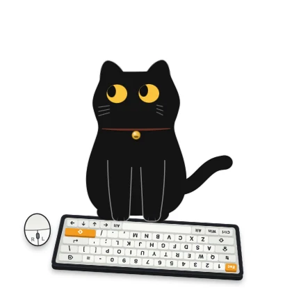
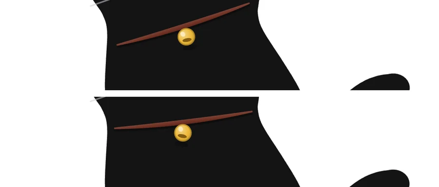

# 🐈‍⬛ KuroCat · 2D 定制分支（`feat/bellblack-2d`）

<p align="center">
  <strong>🇨🇳 简体中文</strong> &nbsp;|&nbsp;
  <a href="./README.en.md">🇺🇸 English</a> &nbsp;|&nbsp;
  <a href="./README.ja.md">🇯🇵 日本語</a>
</p>

这是 [qianyiai/kurocat](https://github.com/qianyiai/kurocat) 的个人定制分支，基于上游 **5.1.0**（本分支版本号改为 **5.2.0**）。上游的键鼠跟随、透明置顶窗口、托盘、密码防偷窥、MCP、3D 引擎等功能全部保留，本文只记录**这个分支新增和修改了什么**。

改动全部落在 **2D 引擎**（`src/catEngine.ts` / `src/catSkins.ts` / `src/main.ts`，以及 `src-tauri` 的菜单与音乐检测），不涉及 3D。

<p align="center">
  
</p>

## 1. 新增角色「铃铛小黑」（`bellblack`）

- **圆颊剪影**：新增 `BODY_SLICES_ROUND` 轮廓（最宽 63.5），比原版小黑脸更圆更软
- **细皮绳 + 金球铃**：砖红皮绳 `#6e2f21`（`THICK 3.4`，两端收成细尖），配径向渐变金球铃（半径 6.2，扁椭圆出音孔），取代原来的宽缎带 + 穹顶铃
- **一笔实体爪**：两条前腿改成一条连续的 `drawSeatedLegPath()`，深色毛上也不会出现"悬空两根线"
- **键盘配色耳机**：耳罩改白键帽配色，去掉耳麦；播放时只飘一个音符，两条交替轨道 + 拥挤保护，音符不会叠在一起
- **独立形象进菜单**：托盘菜单新增 `breed_bellblack` 项「铃铛小黑（圆脸·皮绳铃）」，内嵌菜单「角色外观」里也有同名条目，选中后头部显示 `KuroCat 铃铛小黑`，`settings.json` 的 `catBreed` 落盘为 `bellblack`，重启仍保持

<table>
  <tr>
    <td align="center" width="50%"><br/><sub>按住鼠标：支撑爪有完整实体描边，不再只剩两根悬空线</sub></td>
    <td align="center" width="50%"><br/><sub>真机桌面：圆颊 + 皮绳金铃 + 一笔爪 + 2D 键盘</sub></td>
  </tr>
</table>

## 2. 听歌律动

检测到系统在放音乐（`src-tauri/src/music_detect.rs`，连续采样确认后触发）时进入 groove 状态机：

- **基础律动**：点头 `beatSin*0.078 + beatHalf*0.026`，面部轻摆 `musicNodGain*beatHalf*3.6`，身体重心 `+ musicGroove*sin(phase*0.5)*0.055`，尾巴半频摆动（振幅 6.4）
- **随机一次性动作**：从 `enjoy / enjoy / ear / slowBlink / look / tail / tilt` 池里抽，间隔 2200–5200 ms，BPM 每轮在 92–126 之间随机
- **不打扰打字**：点头增益乘 `(1 - min(1, typingHunch)*0.55)`；`musicGroove < 0.15` 时抑制普通 idle 小动作

<table>
  <tr>
    <td align="center" width="56%"><br/><sub>耳机 + 单音符，音符不重叠</sub></td>
    <td align="center" width="44%"><br/><sub>真机 6 帧：头左右倾、重心换边、尾巴跟着动</sub></td>
  </tr>
</table>

## 3. 闭眼享受

- 新增 `IdleFidget.kind = 'enjoy'`，固定时间睑动：**0.38 s 合、0.45 s 开**，整段时长随机 **2400–3300 ms**
- 闭合度 > 0.55 时走"放松弯眼弧"分支（内置皮肤与自定义皮肤的 `drawEyes` 两条路径都加了 `isBlissClosed()`）
- 闭眼期间点头再乘 `(1 - enjoyEnv*0.45)`，并加 0.042 的侧歪、`targetGazeY -= 0.12*actEnv`，整只猫会"瘫一下"

<p align="center">
  <br/>
  <sub>左：平常睁眼；右：闭眼享受（弯眼弧 + 头部轻微侧歪）</sub>
</p>

## 4. 手感修正

- **支撑爪描边**：`drawCustomPlumpArm` 增加 `supportLook` 参数，深色毛用 `legLineColor` 兜底并补上爪球闭合弧
- **头箍跟随**：`drawHeadphonesBack / drawHeadphonesFront` 加入 `turnShift = faceTurnX*0.125`，横向扭头时头箍与耳罩同比例跟着走
- **项圈倾角收敛**：`collarAnchor()` 的脊柱轴倾斜按侧倾幅度衰减（`leanDamp = 1 - min(1,|spineLean|)*0.66`）。"摸鼠标"这种强侧倾姿态下，皮绳与水平夹角从 **-17.5°** 收到 **-6.9°**，静立仍是 0°，打字轻摆不受影响

<p align="center">
  <br/>
  <sub>同一鼠标姿态：上为修复前（约 -17.5°），下为修复后（约 -6.9°）</sub>
</p>

## 5. 菜单与设置

- `src-tauri/src/tray.rs` 新增 `breed_bellblack` 菜单项与事件；`lib.rs` 的角色列表来自 `all_cats()`，内嵌菜单（`menuMain.ts`）自然多出「铃铛小黑」条目
- `src-tauri/src/music_detect.rs`：新增 `get_music_active` 命令与播放检测轮询，只做"是否在放音乐"的粗判定，不读取曲目信息
- 版本号 `5.1.0 → 5.2.0`：`package.json`、`src-tauri/Cargo.toml`、`src-tauri/tauri.conf.json` 三处同步

<p align="center">
  <br/>
  <sub>「角色外观」里新增独立条目，选中后高亮，菜单头部变为 `KuroCat 铃铛小黑`</sub>
</p>

## 6. 构建与运行

前置：macOS 11+ / Windows 10+、Node.js 18+、Rust 工具链。

```bash
git clone https://github.com/coocv/kurocat.git -b feat/bellblack-2d
cd kurocat
npm install
npm run tauri:dev      # 本地调试
npm run tauri:build    # 打包 Release
```

macOS 若要让「辅助功能 / 输入监控」授权跨版本保留，需要用**固定**的自签名证书签名：`tauri.conf.json` 里不写 `signingIdentity`，打包后手动签名

```bash
codesign --force --deep --sign "你的自签证书名" src-tauri/target/release/bundle/macos/KuroCat.app
```

自签证书不能替代 Apple 公证，首次打开仍需在「隐私与安全性」里放行。

## 7. 范围与已知限制

- 只做 **2D**，3D 引擎（`catEngine3d.ts`）没有任何改动
- 新形象是内置 breed（`bellblack`），不是 `cats.json` 里的自定义皮肤；想改成纯自定义皮肤，需要把项圈、耳机这些绘制分支参数化
- 若你之前在 `cats.json` 的自建皮肤里用 spots 拼过项圈，那些旧贴片不会被本分支自动清除，需要手动删
- `src-tauri/gen/schemas` 这类构建产物不入库，已加入 `.gitignore`

## 8. 上游与许可

上游项目与文档：[qianyiai/kurocat](https://github.com/qianyiai/kurocat)，MIT License（见 [LICENSE](LICENSE)）。本分支只改 2D 渲染与角色，原项目的署名与许可声明全部保留。
